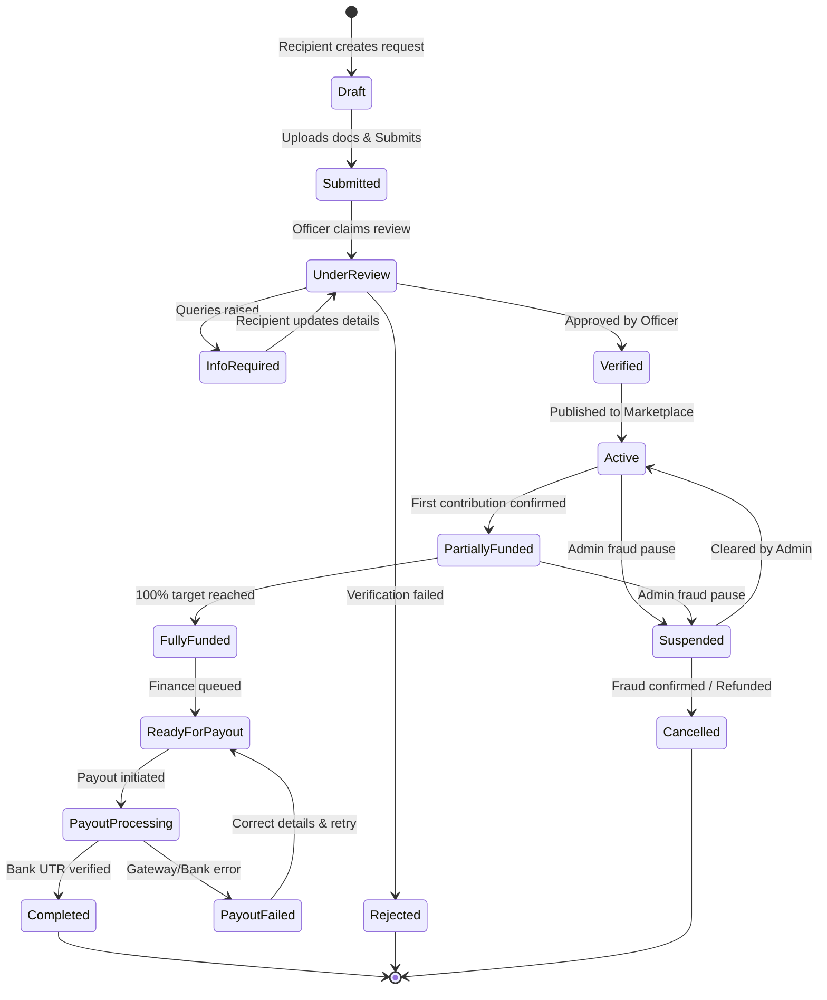

# HelpBridge — Product Requirements Document (PRD)
**Document Version:** 1.0.0  
**Status:** Approved for Baseline Architecture  
**Product Name:** HelpBridge  
**Core Promise:** *Every contribution has a verified purpose. Every transaction has a traceable outcome.*

---

## 1. Executive Summary & Product Vision

### 1.1 Vision Statement
HelpBridge is a next-generation, high-trust financial assistance marketplace connecting verified individuals with legitimate financial distress directly to donors. Unlike generic crowdfunding platforms that rely on unverified claims, emotional manipulation, or opaque fund distribution, HelpBridge pairs institutional-grade document verification, direct-to-biller payout mechanisms, and a double-entry transparent ledger.

### 1.2 Core Product Tenets
1. **Purpose Verification:** Financial assistance requests must be substantiated with authoritative institutional documentation (e.g., college fee invoices, hospital bills) verified by trained compliance personnel and assisted by automated OCR/AI tools.
2. **Outcome Traceability:** Donors do not donate into a black box. The system tracks the lifecycle from donor checkout to settlement and direct institutional payout or verified beneficiary confirmation.
3. **No Frontend-Only Trust:** All state transitions, role authorizations, financial ledger calculations, and fraud checks are strictly enforced server-side.
4. **Ethical Generosity:** No dark patterns, guilt-tripping notifications, artificial countdown timers, or hidden commission deductions.
5. **Architectural Discipline:** Built as a scalable, clean Modular Monolith in ASP.NET Core and Angular, primed for future international expansion while starting with a rock-solid domestic foundation.

---

## 2. Target Personas & User Roles

### 2.1 Persona Matrix
| Persona | Role | Primary Objective | Key Pain Point Addressed |
|---|---|---|---|
| **Rahul (Student / Patient)** | `Recipient` | Raise urgent funds for legitimate education or medical obligations without shame or bureaucratic exploitation. | High interest informal debt; inability to prove authenticity on social media. |
| **James (Philanthropist / Donor)** | `Donor` | Discover genuine, verified human needs and contribute with 100% confidence that funds reach the real cause. | Distrust of crowdfunding scams, lack of visibility into where money actually went. |
| **Ananya (Verification Officer)** | `VerificationOfficer` | Rapidly inspect uploaded invoices, run fraud checks, cross-reference billers, and approve/reject requests. | Overwhelmed by forged PDFs, manual data entry, lack of audit trails. |
| **Vikram (Finance Manager)** | `FinanceManager` | Manage payment reconciliation, execute approved institutional payouts, handle refunds, and ensure zero ledger imbalance. | Discrepancies between payment gateway reports and bank settlements. |
| **Priya (Platform Administrator)** | `SuperAdmin` / `SupportAgent` | Oversee system health, handle disputes, manage user privileges, and monitor fraud telemetry. | Fragmented administrative tools and incomplete audit logs. |

---

## 3. Product Scope & Phasing

### 3.1 Version 1.0 (MVP Scope — Domestic India Foundation)
- **Geographic Focus:** India domestic transactions (INR - Indian Rupee).
- **Core Assistance Categories:** 
  1. *Education* (College tuition fees, semester exam fees, vocational training).
  2. *Medical* (Hospital inpatient/outpatient invoices, surgical estimates, diagnostic labs).
- **Payment Processing:** Integrated domestic gateway with simulated provider sandbox mode, webhook idempotency, split fee transparency, and escrow/nodal fund tracking.
- **Verification Engine:** Multi-step verification workflow with document upload, OCR data extraction, fraud detection flags, and manual human approval.
- **Donor Interface:** Modern Fintech discovery feed, interactive swipe discovery, detailed request inspection, and one-click transparent contribution.
- **Ledger & Payouts:** Direct-to-biller payment queue with payout confirmation tracking.

### 3.2 Excluded from Version 1.0 (Deferred to V2/V3)
- Foreign contribution inflows requiring FCRA (Foreign Contribution Regulation Act) registration.
- Native mobile applications (iOS/Android) — V1 web application will be fully responsive and PWA-ready.
- Peer-to-peer personal cash loans or micro-credit lending.
- Cryptocurrency or unregulated token donations.
- Unmoderated public direct-messaging between donors and recipients.
- 100% autonomous AI approval without human verification sign-off.

---

## 4. Epic & User Story Specifications

### Epic 1: Identity & Access Management (IAM)
#### US-1.1: Recipient & Donor Registration
- **As a** new user (Recipient or Donor),
- **I want to** register with my email, phone number, and a secure password,
- **So that** I can create a secure account tailored to my intended activity.
- **Acceptance Criteria:**
  - *Given* a valid email and phone number, *When* submitted with a password meeting complexity rules (min 8 chars, 1 uppercase, 1 digit, 1 special symbol), *Then* an account is provisioned in `Unverified` state and an email confirmation token is generated.
  - Rate limiting must prevent registration floods (>5 requests/min per IP returns HTTP 429).
  - Clear terms of service and DPDP Act-compliant privacy consent checkboxes are mandatory.

#### US-1.2: Multi-Factor Authentication for Privileged Roles
- **As a** Verification Officer or Finance Manager,
- **I want to** authenticate using TOTP-based two-factor authentication,
- **So that** administrative and financial operations are shielded from credential compromise.
- **Acceptance Criteria:**
  - Administrative roles (`SuperAdmin`, `FinanceManager`, `VerificationOfficer`) cannot access backend operations without verified MFA.
  - JWT tokens for admin roles expire in 15 minutes; refresh tokens rotate on every refresh call.

---

### Epic 2: Recipient Assistance Request Lifecycle
#### US-2.1: Request Creation & Category Selection
- **As a** verified recipient,
- **I want to** create a new assistance request under Education or Medical,
- **So that** I can ask the community for financial support for a specific obligation.
- **Acceptance Criteria:**
  - User enters title, narrative description, required amount in INR (minimum ₹1,000; maximum capped by category limits, e.g., ₹2,50,000 for standard MVP tier).
  - Recipient provides official biller/institution details (Name, College/Hospital Registration Number, Bank Account / UPI / Bill Desk Reference).
  - The request is saved as `Draft` until mandatory documents are uploaded and explicit "Submit for Verification" is triggered.

#### US-2.2: Supporting Document Upload
- **As a** recipient,
- **I want to** upload invoices, fee circulars, and identity proofs,
- **So that** verification officers can authenticate my need.
- **Acceptance Criteria:**
  - Allowed MIME types: `application/pdf`, `image/jpeg`, `image/png`. Max size: 10MB per file.
  - File headers (magic bytes) must be checked on the backend to prevent malicious disguised executables.
  - Files are uploaded directly to private Azure Blob containers; no public read access is permitted.
  - Recipient can view uploaded documents only via short-lived SAS URLs (15-minute expiration).

---

### Epic 3: Verification & Fraud Prevention Workflow
#### US-3.1: Document Verification Queue
- **As a** Verification Officer,
- **I want to** view a prioritized queue of submitted assistance requests,
- **So that** I can systematically evaluate documents against institutional claims.
- **Acceptance Criteria:**
  - Queue displays: Request ID, Category, Recipient Name, Amount Claimed, Submission Date, AI Risk Score, and OCR Status.
  - Claims cannot be approved without viewing the uploaded documents.
  - System checks for duplicate document hashes (SHA-256) across all historical requests to immediately flag recycled bills.

#### US-3.2: AI & OCR Assisted Document Parsing
- **As a** Verification Officer,
- **I want** the system to extract the invoice amount, bill number, biller name, and due date using OCR/AI,
- **So that** I can immediately cross-reference claimed amounts against the actual document.
- **Acceptance Criteria:**
  - OCR populates suggested fields with confidence scores (0–100%).
  - Mismatches between Recipient Claimed Amount and Document Invoice Amount are highlighted with warning badges.
  - AI is an assistant; final `Approve` or `Reject` decision requires an officer's authenticated signature and reason code.

---

### Epic 4: Donor Discovery & Interaction
#### US-4.1: Curated Discovery Feed
- **As a** donor,
- **I want to** browse verified assistance requests filtered by category, urgency, and funding progress,
- **So that** I can identify causes that resonate with my philanthropic goals.
- **Acceptance Criteria:**
  - Only requests in `Active` or `PartiallyFunded` statuses appear in public discovery.
  - Each card showcases: Verified Badge, Category, Recipient First Name & Initial (privacy mode), Goal Amount, Amount Raised, Progress Bar (%), Supporter Count, and Days Remaining.
  - Search query executes against request titles, categories, and tags.

#### US-4.2: Swipe Discovery Interface
- **As a** mobile or desktop donor,
- **I want to** interactively browse requests using an intuitive swipe gesture,
- **So that** I can quickly bookmark or contribute to causes.
- **Acceptance Criteria:**
  - Swipe Right: Marks request as "Interested" and adds it to the user's `SavedRequests` list.
  - Swipe Left: Dismisses card and advances to next recommendation.
  - Tap / Click: Expands into full Transparency Details Modal.
  - **Critical Rule:** Swiping never triggers a financial charge or creates a payment intent without explicit user checkout confirmation.

---

### Epic 5: Contribution & Payment Processing
#### US-5.1: Transparent Contribution Checkout
- **As a** donor,
- **I want to** choose a contribution amount and view an itemized breakdown of platform fees and taxes,
- **So that** I know exactly how much goes directly to the recipient's cause.
- **Acceptance Criteria:**
  - Suggested contribution chips (e.g., ₹500, ₹1,000, ₹2,500, Custom).
  - Explicit fee breakdown displayed before payment submission:
    - Net Assistance Contribution: 100% of selected amount.
    - Payment Gateway Fee (approx. 2% + GST): Transparently indicated or absorbed per platform policy.
    - Voluntary Platform Tip (Default: 5%, adjustable to 0%).
  - Backend creates a `DonationIntent` with a unique cryptographic idempotency key.

#### US-5.2: Payment Gateway Integration & Webhook Reconciliation
- **As a** system,
- **I want to** verify payment provider webhooks cryptographically before crediting contributions,
- **So that** no donation is recorded based on manipulated client-side redirect parameters.
- **Acceptance Criteria:**
  - Webhooks from Razorpay/Cashfree must have their HMAC SHA-256 signatures validated against the stored webhook secret.
  - Duplicate webhook events are rejected idempotently using Gateway Payment ID.
  - Upon verified `PaymentSuccess`, the system atomically creates a ledger entry, updates the request's `FundedAmount`, checks if the target is met, and broadcasts real-time SignalR events.
  - If a request receives a contribution that pushes it to 100%, the status transitions to `FullyFunded` and no further payments are accepted.

---

### Epic 6: Payout & Outcome Tracking
#### US-6.1: Direct-to-Biller Payout Initiation
- **As a** Finance Manager,
- **I want to** execute payout for a `FullyFunded` request directly to the institution's verified bank account,
- **So that** money is never misappropriated or diverted.
- **Acceptance Criteria:**
  - Payout details must match the verified biller account on the approved document.
  - Payout requires dual-authorization (Maker-Checker principle) for amounts exceeding ₹50,000.
  - Status changes from `ReadyForPayout` to `PayoutProcessing`, then `PayoutSuccess` upon bank confirmation.

#### US-6.2: Outcome Confirmation & Donor Notification
- **As a** donor who contributed to a request,
- **I want to** receive notification and view proof when the institution is paid,
- **So that** I can experience the tangible impact of my gift.
- **Acceptance Criteria:**
  - Platform uploads official institutional payment receipt / UTR reference number.
  - All contributing donors receive an email and in-app impact update with the UTR reference (masked for recipient privacy).
  - The request status advances to `Completed`.

---

## 5. System State Machines & Business Rules

### 5.1 Assistance Request State Machine

### 5.2 Business Rules Matrix
| Rule ID | Domain | Rule Definition | Enforcement Layer |
|---|---|---|---|
| **BR-01** | Verification | A recipient cannot approve, verify, or change the status of their own request. | API Authorization Filter |
| **BR-02** | Target Capping | Contributions cannot exceed `TargetAmount - FundedAmount`. Excess intents must be rejected or automatically adjusted. | Database Transaction / Application Service |
| **BR-03** | Document Privacy | Documents are never publicly indexed or accessible without an authenticated user token bearing specific permission. | Storage Controller / Signed SAS |
| **BR-04** | Webhook Idempotency | A payment transaction cannot be processed more than once regardless of webhook retries. | Unique Index on `PaymentTransaction.GatewayTransactionId` + Idempotency Filter |
| **BR-05** | Financial Immutability | Completed donations and payout transactions cannot be updated or deleted; corrections require compensatory ledger reversal entries. | DB Triggers & Repository Constraints |
| **BR-06** | Payout Decoupling | Donor payment success MUST NEVER be conflated with beneficiary payout success. | Distinct State Entities (`Donation` vs `Payout`) |

---

## 6. Success Metrics & Key Performance Indicators (KPIs)

1. **Assistance Delivery Ratio:** $\frac{\text{Successfully Paid Out Requests}}{\text{Fully Funded Requests}} = 100\%$
2. **Verification Turnaround Time (TAT):** Average time from `Submitted` to `Verified`/`Rejected` $\le 24 \text{ hours}$.
3. **Fraud Zero-Tolerance:** $< 0.01\%$ chargeback or reported fraud rate on verified requests.
4. **Donor Retention Rate:** $> 35\%$ of donors making a second contribution within 90 days.
5. **Ledger Discrepancy:** $0.00$ variance between gateway gross collections and internal ledger balances.

---

## 7. Definition of Done (DoD) for MVP V1.0

The HelpBridge V1.0 product is officially done and ready for deployment when:
1. End-to-end Recipient Journey passes: Registration $\to$ Draft Request $\to$ Doc Upload $\to$ Verification $\to$ Publish $\to$ Receive Funding $\to$ Confirmation.
2. End-to-end Donor Journey passes: Registration $\to$ Discover / Swipe $\to$ Detailed View $\to$ Payment Checkout (Simulated/Gateway) $\to$ Receipt $\to$ Impact Notification.
3. Verification Officer Portal functions with complete Document Viewer, OCR summary, Approve/Reject/RFI actions, and tamper-proof audit trail.
4. Finance Payout Workflow operates with dual-control maker-checker, UTR logging, and double-entry ledger balancing.
5. All 10 critical automated security tests pass (IDOR protection, role escalation prevention, negative balance checks, replay attack mitigation).

