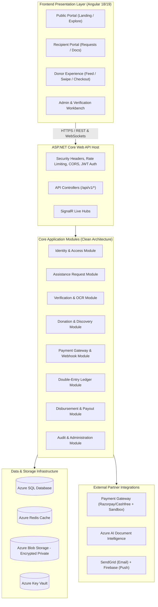
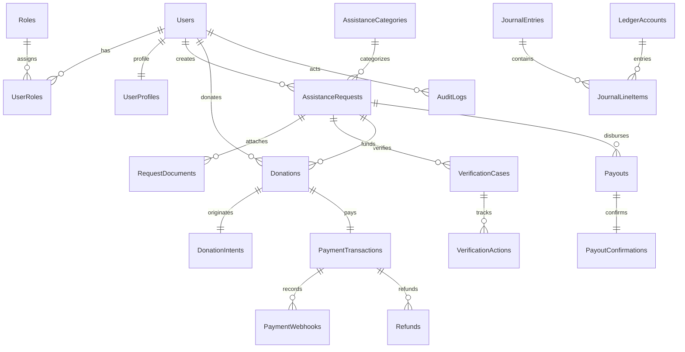

# HelpBridge — Technical Architecture & System Design Document
**Document Version:** 1.0.0  
**Pattern:** Modular Monolith with Clean Architecture & Event-Driven Subsystems  
**Target Runtimes:** .NET 8 / 9 (C#) & Angular 18 / 19  

---

## 1. System Architecture Overview

HelpBridge is architected as an enterprise-grade **Modular Monolith**. Rather than prematurely fracturing into distributed microservices—which introduces complex distributed transactions, network latency, and operational overhead—the Modular Monolith encapsulates business domains into strictly isolated modules within a unified process and database boundary.

### 1.1 High-Level Architecture Diagram


---

## 2. Solution Directory Structure

The codebase is organized following Clean Architecture principles across solution folders:

```
d:\HelpBridge\
│
├── docs/                                  # Specifications (PRD, SRS, Architecture, Roadmap)
│
├── src/
│   ├── HelpBridge.Domain/                 # Core Entities, Enums, Value Objects, Domain Events
│   │   ├── Common/                        # BaseEntity, IAggregateRoot, ValueObject
│   │   ├── Identity/                      # ApplicationUser, ApplicationRole
│   │   ├── Assistance/                    # AssistanceRequest, Category, RequestDocument
│   │   ├── Verification/                  # VerificationCase, VerificationAction
│   │   ├── Donations/                     # Donation, DonationIntent, SavedRequest
│   │   ├── Payments/                      # PaymentTransaction, PaymentWebhook, Refund
│   │   ├── Payouts/                       # PayoutRecord, PayoutConfirmation
│   │   ├── Accounting/                    # LedgerAccount, JournalEntry, JournalLineItem
│   │   └── Administration/                # AuditLog, SupportTicket, PlatformMetric
│   │
│   ├── HelpBridge.Application/              # Use Cases, CQRS Commands/Queries, DTOs, Behaviors
│   │   ├── Common/                        # Behaviors (Validation, Logging, Idempotency), Result<T>
│   │   ├── Features/
│   │   │   ├── Identity/                  # Login, Register, RefreshToken, 2FA Commands
│   │   │   ├── Requests/                  # CreateRequest, SubmitRequest, UpdateStatus
│   │   │   ├── Verification/              # AssignCase, ReviewDocument, ApproveRequest
│   │   │   ├── Discovery/                 # GetDiscoveryFeed, GetSwipeCardsQuery
│   │   │   ├── Donations/                 # CreateDonationIntent, GetDonationHistory
│   │   │   ├── Payments/                  # ProcessWebhook, VerifyPaymentCommand
│   │   │   ├── Payouts/                   # QueuePayout, ConfirmBillerPayoutCommand
│   │   │   └── Administration/            # GetAdminDashboardMetricsQuery
│   │   └── Interfaces/                    # IApplicationDbContext, IPaymentProvider, IBlobStorage
│   │
│   ├── HelpBridge.Infrastructure/         # EF Core, External Adapters, Azure SDK, Services
│   │   ├── Persistence/                   # AppDbContext, Configurations, Migrations, LedgerEngine
│   │   ├── Identity/                      # IdentityService, TokenGenerator
│   │   ├── Storage/                       # AzureBlobStorageService, SasTokenGenerator
│   │   ├── Payments/                      # RazorpayPaymentProvider, SimulatedPaymentProvider
│   │   ├── AI/                            # AzureDocumentIntelligenceOcrService
│   │   ├── Notifications/                 # SendGridEmailService, FirebasePushService
│   │   └── Caching/                       # RedisCacheService
│   │
│   ├── HelpBridge.Api/                    # ASP.NET Core Host, Controllers, Middleware, Filters
│   │   ├── Controllers/                   # Versioned REST Controllers (v1)
│   │   ├── Hubs/                          # SignalR Hubs (Real-time updates)
│   │   ├── Middleware/                    # GlobalExceptionMiddleware, IdempotencyMiddleware
│   │   └── Program.cs                     # DI Registrations, Pipeline Configuration
│   │
│   └── HelpBridge.WebClient/              # Angular 18/19 SPA
│       ├── src/
│       │   ├── app/
│       │   │   ├── core/                  # Services, Interceptors, Guards, Models
│       │   │   ├── shared/                # UI Components (Buttons, Modals, Cards, Progress)
│       │   │   └── features/
│       │   │       ├── auth/              # Login, Register, 2FA
│       │   │       ├── recipient/         # Dashboard, Create Request, Document Upload
│       │   │       ├── donor/             # Discovery Feed, Swipe Deck, Checkout
│       │   │       ├── admin/             # Verification Queue, Financial Ops, Audit Logs
│       │   │       └── public/            # Landing Page, How It Works, Policies
│       │   └── assets/                    # Icons, Logos, Styling tokens
│
└── tests/
    ├── HelpBridge.UnitTests/              # Domain logic & Application handler tests
    ├── HelpBridge.IntegrationTests/       # Database & API workflow tests
    └── HelpBridge.SecurityTests/          # Auth bypass, IDOR, and Idempotency tests
```

---

## 3. Comprehensive Database Schema & Entity Relational Design

The database schema is enforced using SQL Server with Entity Framework Core migrations. All currency amounts are stored with strict four-decimal precision `decimal(18,4)` to prevent floating-point rounding errors.

### 3.1 Entity Relationship Diagram (ERD)


### 3.2 Master Entity Inventory & DDL Specifications

#### 1. Identity & Profile Tables
- `Users`
  - `Id` (NVARCHAR(450), PK - GUID)
  - `UserName` (NVARCHAR(256), NOT NULL, UNIQUE)
  - `Email` (NVARCHAR(256), NOT NULL, UNIQUE)
  - `EmailConfirmed` (BIT, NOT NULL)
  - `PhoneNumber` (NVARCHAR(50), NOT NULL)
  - `PhoneNumberConfirmed` (BIT, NOT NULL)
  - `PasswordHash` (NVARCHAR(MAX), NOT NULL)
  - `SecurityStamp` (NVARCHAR(MAX))
  - `TwoFactorEnabled` (BIT, NOT NULL, DEFAULT 0)
  - `LockoutEnd` (DATETIMEOFFSET)
  - `CreatedUtc` (DATETIME2, NOT NULL, DEFAULT SYSUTCDATETIME())
  - `IsActive` (BIT, NOT NULL, DEFAULT 1)

- `UserProfiles`
  - `UserId` (NVARCHAR(450), PK, FK -> Users.Id)
  - `FirstName` (NVARCHAR(100), NOT NULL)
  - `LastName` (NVARCHAR(100), NOT NULL)
  - `AvatarUrl` (NVARCHAR(1000), NULL)
  - `City` (NVARCHAR(100), NOT NULL)
  - `State` (NVARCHAR(100), NOT NULL)
  - `CountryCode` (CHAR(2), NOT NULL, DEFAULT 'IN')
  - `IdentityDocType` (NVARCHAR(50), NULL)
  - `IdentityDocMaskedNumber` (NVARCHAR(50), NULL)
  - `IdentityVerified` (BIT, NOT NULL, DEFAULT 0)
  - `UpdatedUtc` (DATETIME2, NOT NULL)

- `Roles` & `UserRoles` (Standard ASP.NET Identity roles: `SuperAdmin`, `FinanceManager`, `VerificationOfficer`, `SupportAgent`, `Recipient`, `Donor`).

#### 2. Assistance & Document Tables
- `AssistanceCategories`
  - `Id` (INT, PK, IDENTITY)
  - `Code` (NVARCHAR(50), NOT NULL, UNIQUE: `EDUCATION`, `MEDICAL`, `BILLS`, `HOUSING`)
  - `DisplayName` (NVARCHAR(100), NOT NULL)
  - `MaxAllowedAmount` (DECIMAL(18,4), NOT NULL)
  - `IsActive` (BIT, NOT NULL, DEFAULT 1)

- `AssistanceRequests`
  - `Id` (UNIQUEIDENTIFIER, PK, DEFAULT NEWSEQUENTIALID())
  - `RecipientId` (NVARCHAR(450), NOT NULL, FK -> Users.Id)
  - `CategoryId` (INT, NOT NULL, FK -> AssistanceCategories.Id)
  - `Title` (NVARCHAR(150), NOT NULL)
  - `Story` (NVARCHAR(MAX), NOT NULL)
  - `TargetAmount` (DECIMAL(18,4), NOT NULL)
  - `FundedAmount` (DECIMAL(18,4), NOT NULL, DEFAULT 0.0000)
  - `Currency` (CHAR(3), NOT NULL, DEFAULT 'INR')
  - `Status` (NVARCHAR(50), NOT NULL, DEFAULT 'Draft') -- [Draft, Submitted, UnderReview, InfoRequired, Verified, Active, PartiallyFunded, FullyFunded, ReadyForPayout, Completed, Suspended, Cancelled, Expired]
  - `DueDate` (DATE, NOT NULL)
  - `BillerName` (NVARCHAR(200), NOT NULL)
  - `BillerReferenceNumber` (NVARCHAR(100), NOT NULL)
  - `BillerBankAccountNumber` (NVARCHAR(100), NOT NULL)
  - `BillerIfscOrCode` (NVARCHAR(50), NOT NULL)
  - `CreatedUtc` (DATETIME2, NOT NULL, DEFAULT SYSUTCDATETIME())
  - `VerifiedUtc` (DATETIME2, NULL)
  - `CompletedUtc` (DATETIME2, NULL)
  - `RowVersion` (ROWVERSION) -- Concurrency control

- `RequestDocuments`
  - `Id` (UNIQUEIDENTIFIER, PK, DEFAULT NEWSEQUENTIALID())
  - `RequestId` (UNIQUEIDENTIFIER, NOT NULL, FK -> AssistanceRequests.Id)
  - `DocumentType` (NVARCHAR(50), NOT NULL) -- [FeeReceipt, HospitalBill, IDProof, SalarySlip, RentAgreement]
  - `BlobPath` (NVARCHAR(1000), NOT NULL)
  - `OriginalFileName` (NVARCHAR(255), NOT NULL)
  - `ContentType` (NVARCHAR(100), NOT NULL)
  - `FileSizeBytes` (BIGINT, NOT NULL)
  - `Sha256Checksum` (CHAR(64), NOT NULL) -- Duplicate detection
  - `UploadedUtc` (DATETIME2, NOT NULL, DEFAULT SYSUTCDATETIME())

- `VerificationCases`
  - `Id` (UNIQUEIDENTIFIER, PK, DEFAULT NEWSEQUENTIALID())
  - `RequestId` (UNIQUEIDENTIFIER, NOT NULL, UNIQUE, FK -> AssistanceRequests.Id)
  - `AssignedOfficerId` (NVARCHAR(450), NULL, FK -> Users.Id)
  - `Status` (NVARCHAR(50), NOT NULL, DEFAULT 'Pending')
  - `OcrExtractedAmount` (DECIMAL(18,4), NULL)
  - `OcrExtractedBiller` (NVARCHAR(200), NULL)
  - `OcrConfidenceScore` (DECIMAL(5,2), NULL)
  - `AiRiskScore` (DECIMAL(5,2), NULL)
  - `AiRiskFlags` (NVARCHAR(MAX), NULL) -- JSON array of detected flags
  - `DecisionUtc` (DATETIME2, NULL)

- `VerificationActions`
  - `Id` (BIGINT, PK, IDENTITY)
  - `VerificationCaseId` (UNIQUEIDENTIFIER, NOT NULL, FK -> VerificationCases.Id)
  - `OfficerId` (NVARCHAR(450), NOT NULL, FK -> Users.Id)
  - `ActionType` (NVARCHAR(50), NOT NULL) -- [Claimed, Queried, Approved, Rejected, Escalated]
  - `Notes` (NVARCHAR(MAX), NOT NULL)
  - `TimestampUtc` (DATETIME2, NOT NULL, DEFAULT SYSUTCDATETIME())

#### 3. Donations, Payments & Financial Tables
- `DonationIntents`
  - `Id` (UNIQUEIDENTIFIER, PK, DEFAULT NEWSEQUENTIALID())
  - `DonorId` (NVARCHAR(450), NOT NULL, FK -> Users.Id)
  - `RequestId` (UNIQUEIDENTIFIER, NOT NULL, FK -> AssistanceRequests.Id)
  - `AssistanceAmount` (DECIMAL(18,4), NOT NULL)
  - `TipAmount` (DECIMAL(18,4), NOT NULL, DEFAULT 0.0000)
  - `TotalAmount` (DECIMAL(18,4), NOT NULL)
  - `Currency` (CHAR(3), NOT NULL, DEFAULT 'INR')
  - `IdempotencyKey` (NVARCHAR(100), NOT NULL, UNIQUE)
  - `ExpiresUtc` (DATETIME2, NOT NULL)
  - `Status` (NVARCHAR(50), NOT NULL, DEFAULT 'Pending') -- [Pending, Completed, Expired, Cancelled]

- `Donations`
  - `Id` (UNIQUEIDENTIFIER, PK, DEFAULT NEWSEQUENTIALID())
  - `IntentId` (UNIQUEIDENTIFIER, NOT NULL, UNIQUE, FK -> DonationIntents.Id)
  - `DonorId` (NVARCHAR(450), NOT NULL, FK -> Users.Id)
  - `RequestId` (UNIQUEIDENTIFIER, NOT NULL, FK -> AssistanceRequests.Id)
  - `GrossAmount` (DECIMAL(18,4), NOT NULL)
  - `AssistanceAmount` (DECIMAL(18,4), NOT NULL)
  - `PlatformTipAmount` (DECIMAL(18,4), NOT NULL, DEFAULT 0.0000)
  - `Currency` (CHAR(3), NOT NULL, DEFAULT 'INR')
  - `IsAnonymous` (BIT, NOT NULL, DEFAULT 0)
  - `ConfirmedUtc` (DATETIME2, NOT NULL, DEFAULT SYSUTCDATETIME())

- `PaymentTransactions`
  - `Id` (UNIQUEIDENTIFIER, PK, DEFAULT NEWSEQUENTIALID())
  - `DonationId` (UNIQUEIDENTIFIER, NOT NULL, UNIQUE, FK -> Donations.Id)
  - `ProviderName` (NVARCHAR(50), NOT NULL) -- [Razorpay, Cashfree, Simulated]
  - `GatewayOrderId` (NVARCHAR(100), NOT NULL)
  - `GatewayPaymentId` (NVARCHAR(100), NULL, UNIQUE)
  - `PaymentStatus` (NVARCHAR(50), NOT NULL) -- [Created, Pending, Success, Failed, Reconciled]
  - `GatewayFee` (DECIMAL(18,4), NOT NULL, DEFAULT 0.0000)
  - `GatewayTax` (DECIMAL(18,4), NOT NULL, DEFAULT 0.0000)
  - `PaidUtc` (DATETIME2, NULL)
  - `ReconciledUtc` (DATETIME2, NULL)

- `PaymentWebhooks`
  - `Id` (BIGINT, PK, IDENTITY)
  - `ProviderName` (NVARCHAR(50), NOT NULL)
  - `EventId` (NVARCHAR(100), NOT NULL, UNIQUE)
  - `EventType` (NVARCHAR(100), NOT NULL)
  - `RawPayload` (NVARCHAR(MAX), NOT NULL)
  - `Signature` (NVARCHAR(500), NOT NULL)
  - `ProcessedStatus` (NVARCHAR(50), NOT NULL) -- [Processed, Duplicate, InvalidSignature, Failed]
  - `ReceivedUtc` (DATETIME2, NOT NULL, DEFAULT SYSUTCDATETIME())

#### 4. Payout & Disbursement Tables
- `Payouts`
  - `Id` (UNIQUEIDENTIFIER, PK, DEFAULT NEWSEQUENTIALID())
  - `RequestId` (UNIQUEIDENTIFIER, NOT NULL, FK -> AssistanceRequests.Id)
  - `DisbursedAmount` (DECIMAL(18,4), NOT NULL)
  - `Currency` (CHAR(3), NOT NULL, DEFAULT 'INR')
  - `Status` (NVARCHAR(50), NOT NULL) -- [ReadyForPayout, PayoutProcessing, PayoutSuccess, PayoutFailed, Completed]
  - `InitiatedByUserId` (NVARCHAR(450), NOT NULL, FK -> Users.Id)
  - `ApprovedByUserId` (NVARCHAR(450), NULL, FK -> Users.Id) -- Maker-Checker
  - `InitiatedUtc` (DATETIME2, NOT NULL, DEFAULT SYSUTCDATETIME())
  - `CompletedUtc` (DATETIME2, NULL)

- `PayoutConfirmations`
  - `Id` (UNIQUEIDENTIFIER, PK, DEFAULT NEWSEQUENTIALID())
  - `PayoutId` (UNIQUEIDENTIFIER, NOT NULL, UNIQUE, FK -> Payouts.Id)
  - `BankUtrNumber` (NVARCHAR(100), NOT NULL, UNIQUE)
  - `ReceiptBlobPath` (NVARCHAR(1000), NULL)
  - `PaymentMode` (NVARCHAR(50), NOT NULL) -- [NEFT, RTGS, IMPS, DirectTransfer]
  - `ConfirmedUtc` (DATETIME2, NOT NULL, DEFAULT SYSUTCDATETIME())

#### 5. Double-Entry Financial Ledger Tables
- `LedgerAccounts`
  - `Id` (INT, PK, IDENTITY)
  - `AccountCode` (NVARCHAR(50), NOT NULL, UNIQUE) -- e.g., '1010-GATEWAY-CLEARING', '2010-ESCROW-LIABILITY', '4010-PLATFORM-TIPS'
  - `AccountName` (NVARCHAR(100), NOT NULL)
  - `AccountType` (NVARCHAR(50), NOT NULL) -- [Asset, Liability, Equity, Revenue, Expense]
  - `Balance` (DECIMAL(18,4), NOT NULL, DEFAULT 0.0000)

- `JournalEntries`
  - `Id` (UNIQUEIDENTIFIER, PK, DEFAULT NEWSEQUENTIALID())
  - `ReferenceType` (NVARCHAR(50), NOT NULL) -- [Donation, Payout, Refund, GatewayFee]
  - `ReferenceId` (UNIQUEIDENTIFIER, NOT NULL)
  - `Description` (NVARCHAR(255), NOT NULL)
  - `CreatedUtc` (DATETIME2, NOT NULL, DEFAULT SYSUTCDATETIME())

- `JournalLineItems`
  - `Id` (BIGINT, PK, IDENTITY)
  - `JournalEntryId` (UNIQUEIDENTIFIER, NOT NULL, FK -> JournalEntries.Id)
  - `LedgerAccountId` (INT, NOT NULL, FK -> LedgerAccounts.Id)
  - `DebitAmount` (DECIMAL(18,4), NOT NULL, DEFAULT 0.0000)
  - `CreditAmount` (DECIMAL(18,4), NOT NULL, DEFAULT 0.0000)

#### 6. System & Audit Tables
- `AuditLogs`
  - `Id` (BIGINT, PK, IDENTITY)
  - `ActorUserId` (NVARCHAR(450), NULL)
  - `Action` (NVARCHAR(100), NOT NULL)
  - `EntityName` (NVARCHAR(100), NOT NULL)
  - `EntityId` (NVARCHAR(100), NOT NULL)
  - `OldValuesJson` (NVARCHAR(MAX), NULL)
  - `NewValuesJson` (NVARCHAR(MAX), NULL)
  - `IpAddress` (NVARCHAR(45), NOT NULL)
  - `UserAgent` (NVARCHAR(500), NULL)
  - `TimestampUtc` (DATETIME2, NOT NULL, DEFAULT SYSUTCDATETIME())

- `SavedRequests` (Donor bookmarks)
  - `Id` (BIGINT, PK, IDENTITY)
  - `DonorId` (NVARCHAR(450), NOT NULL, FK -> Users.Id)
  - `RequestId` (UNIQUEIDENTIFIER, NOT NULL, FK -> AssistanceRequests.Id)
  - `CreatedUtc` (DATETIME2, NOT NULL, DEFAULT SYSUTCDATETIME())
  - UNIQUE(`DonorId`, `RequestId`)

---

## 4. Double-Entry Accounting Matrix

Every monetary movement creates an infallible journal entry where $\sum \text{Debits} = \sum \text{Credits}$:

### 4.1 Donor Contribution Entry (₹1,000 assistance + ₹50 tip)
| Line | Account Name | Account Type | Debit (₹) | Credit (₹) |
|---|---|---|---|---|
| 1 | `1010-Gateway-Clearing` | Asset | 1,050.00 | - |
| 2 | `2010-Recipient-Escrow-Liability` | Liability | - | 1,000.00 |
| 3 | `4010-Platform-Voluntary-Tips` | Revenue | - | 50.00 |

### 4.2 Gateway Settlement & Deduction (2% Fee + 18% GST = ₹24.78)
| Line | Account Name | Account Type | Debit (₹) | Credit (₹) |
|---|---|---|---|---|
| 1 | `1000-Bank-Current-Account` | Asset | 1,025.22 | - |
| 2 | `5010-Gateway-Processing-Fee` | Expense | 24.78 | - |
| 3 | `1010-Gateway-Clearing` | Asset | - | 1,050.00 |

### 4.3 Direct-to-Biller Payout Execution (₹50,000 College Tuition)
| Line | Account Name | Account Type | Debit (₹) | Credit (₹) |
|---|---|---|---|---|
| 1 | `2010-Recipient-Escrow-Liability` | Liability | 50,000.00 | - |
| 2 | `1000-Bank-Current-Account` | Asset | - | 50,000.00 |

---

## 5. API Endpoint Specifications

All endpoints conform to `/api/v1/` prefix with standard response wrapping:
```json
{
  "success": true,
  "data": { ... },
  "message": "Operation completed successfully.",
  "errors": [],
  "traceId": "00-4bf92f3577b34da6a3ce929d0e0e4736-00"
}
```

### Core API Route Registry
| Method | Endpoint | Authorization | Description |
|---|---|---|---|
| `POST` | `/api/v1/auth/register` | Anonymous | Register Recipient or Donor account |
| `POST` | `/api/v1/auth/login` | Anonymous | Authenticate & issue JWT/Refresh cookie |
| `POST` | `/api/v1/auth/refresh-token` | Anonymous | Rotate refresh token & reissue JWT |
| `POST` | `/api/v1/auth/2fa/verify` | Authenticated | Validate TOTP 2FA code |
| `GET` | `/api/v1/recipient/dashboard` | `Role(Recipient)` | Load recipient active requests and stats |
| `POST` | `/api/v1/requests` | `Role(Recipient)` | Create a draft assistance request |
| `PUT` | `/api/v1/requests/{id}` | `Role(Recipient)` | Update draft request details |
| `POST` | `/api/v1/requests/{id}/documents` | `Role(Recipient)` | Upload invoice / supporting document |
| `POST` | `/api/v1/requests/{id}/submit` | `Role(Recipient)` | Transition request from Draft to Submitted |
| `GET` | `/api/v1/discovery/feed` | Anonymous | Get paginated verified active requests |
| `GET` | `/api/v1/discovery/swipe` | Anonymous / Donor | Get card deck for swipe experience |
| `GET` | `/api/v1/requests/{id}/details` | Anonymous / Donor | Get full public verified request details |
| `POST` | `/api/v1/donations/intents` | `Role(Donor)` | Create locked donation intent (Idempotent) |
| `POST` | `/api/v1/payments/verify` | `Role(Donor)` | Client payment completion handshake |
| `POST` | `/api/v1/payments/webhook` | Gateway Signature | Cryptographic webhook processor |
| `GET` | `/api/v1/verification/queue` | `Role(VerificationOfficer)` | List pending requests for verification |
| `POST` | `/api/v1/verification/{caseId}/review`| `Role(VerificationOfficer)`| Record Approve / Reject / RFI decision |
| `GET` | `/api/v1/payouts/queue` | `Role(FinanceManager)` | View requests awaiting disbursement |
| `POST` | `/api/v1/payouts/{id}/confirm`| `Role(FinanceManager)` | Confirm payout with Bank UTR reference |
| `GET` | `/api/v1/admin/audit-logs` | `Role(SuperAdmin)` | Query append-only audit trail |

---

## 6. Frontend Angular Architecture

The WebClient is an Angular application optimized for performance, modularity, and accessibility.

### 6.1 State & Component Design
- **Standalone Components:** No `NgModule` boilerplate; standalone routing and components provide lazy-loading and tree-shaking out of the box.
- **Signals & Reactivity:** Angular Signals (`signal`, `computed`, `effect`) drive UI state, replacing heavy RxJS state management for local component state while maintaining RxJS for API streams.
- **Security Interceptors:**
  - `JwtInterceptor`: Attaches `Authorization: Bearer <token>` to protected endpoints.
  - `IdempotencyInterceptor`: Auto-generates and attaches `Idempotency-Key: <UUID>` on mutation endpoints (`POST`, `PUT`).
  - `ErrorInterceptor`: Intercepts 401s for silent refresh token rotation, handles 403 Forbidden with security notices, and formats validation errors into toast notifications.

### 6.2 Visual Tokens & Styling System
- Clean, high-contrast fintech aesthetic matching design guidelines:
  - `--color-primary`: `#14213D` (Deep Navy)
  - `--color-secondary`: `#3157D5` (Royal Blue)
  - `--color-accent`: `#31C48D` (Mint Green)
  - `--color-background`: `#F7F8FC` (Off-white canvas)
  - `--color-surface`: `#FFFFFF` (Card surfaces with subtle elevation)
  - `--color-text-main`: `#172033` (High legibility charcoal)
  - `--color-text-muted`: `#758096` (Supporting labels)

